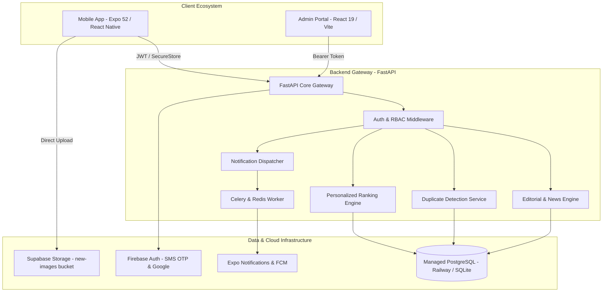

# 📍 City News Telugu — Hyperlocal News & Engagement Platform

[](https://expo.dev/)
[](https://reactnative.dev/)
[](https://www.typescriptlang.org/)
[](https://fastapi.tiangolo.com/)
[](https://www.python.org/)
[](https://railway.app/)
[](LICENSE)

A state-of-the-art **Hyperlocal News & Community Engagement** ecosystem engineered for regional language audiences across Telangana and Andhra Pradesh. The platform bridges the hyperlocal information deficit by delivering real-time, geo-targeted news down to District, City, and neighborhood Locality levels.

The repository houses the complete full-stack solution:
1. **Mobile Application**: Cross-platform client built with React Native and Expo Router.
2. **Backend Services**: High-performance asynchronous REST API powered by FastAPI, SQLAlchemy, Alembic, Celery, and Redis.
3. **Admin & Moderation Portal**: Production editorial dashboard built with React 19 and Vite for news desk editors and administrators.

---

## 🏛️ System Architecture



---

## 🎨 Key Features

- **📍 Hyperlocal Geo-Targeted Feeds**: Dynamically hierarchical news filtering by State (Telangana / Andhra Pradesh), District, City, and neighborhood Localities.
- **🎥 Vertical Video Shorts**: Full-screen, high-performance reels feed for fast-paced municipal updates, video journalism, and breaking alerts.
- **🗳️ Interactive Civic Polls**: Citizen participation on local infrastructure, municipal decisions, and neighborhood issues with real-time tally distribution.
- **💬 Community Social Feed & Discussions**: Neighborhood citizen updates, hashtag conversations, nested comment threads, and community engagement.
- **🔔 Smart Push Notification Engine**: Powered by `expo-notifications` and FCM with channel categorization, quiet hours (DND), geo-fencing, and deep linking.
- **✍️ Publisher Workspace**: Self-publishing portal for verified local journalists and stringers (Role $\ge$ 2) to draft stories, upload imagery, geo-tag content, and monitor reach metrics.
- **🛡️ Admin & Moderation Portal**: Centralized web dashboard for editors to review pending stories, manage duplicate detections, oversee ad campaigns, and configure categories.
- **🌐 Multilingual & Accessible**: Native 6-language engine (**Telugu, English, Hindi, Tamil, Spanish, French**) with dynamic typography accessibility scaling.
- **🌙 Universal Design System**: Smooth Dark and Light themes built on standardized design tokens with Google Poppins and Noto Sans Telugu typography.

---

## 📚 Technical Documentation

Comprehensive architectural and engineering specifications are located in [`docs/`](docs/) and [`backend/`](backend/):

| Document | Focus Area |
| :--- | :--- |
| 🏛️ **[PROJECT_OVERVIEW.md](docs/PROJECT_OVERVIEW.md)** | Technical architecture, audit results, team structure, and delivery roadmap |
| 📐 **[architecture.md](docs/architecture.md)** | Client-side system design, data flow, navigation guards, and state persistence |
| 🔔 **[PUSH_NOTIFICATIONS.md](docs/PUSH_NOTIFICATIONS.md)** | Push notification pipeline, FCM tokens, background handlers, and deep links |
| 🔐 **[RELEASE_SIGNING.md](docs/RELEASE_SIGNING.md)** | Android release keystore generation, Google Play App Signing, and EAS secrets |
| 🧠 **[memory.md](docs/memory.md)** | Living system ledger documenting domain entities, routes, and performance |
| 🗺️ **[api-map.md](docs/api-map.md)** & **[routes.md](docs/routes.md)** | Registry of backend REST endpoints and frontend file-based navigation routes |
| 🗄️ **[database-map.md](docs/database-map.md)** | Relational database schema, foreign keys, and indexes |
| 📊 **[dependency-graph.md](docs/dependency-graph.md)** | Module import dependency graph and cross-package relationships |
| 📋 **[backend_changes_required.md](docs/backend_changes_required.md)** | Route parity, status code alignments, and backend implementation checklist |
| ⚡ **[backend/README.md](backend/README.md)** | FastAPI backend services, Celery workers, and Admin Portal documentation |
| 🐳 **[backend/DOCKER_DEPLOYMENT.md](backend/DOCKER_DEPLOYMENT.md)** | Docker, Nginx, and Railway production container deployment guide |

---

## 🛠️ Tech Stack Breakdown

### Mobile Client (Frontend)
- **Framework**: Expo (Managed Workflow, `~52.0.23`) & React Native (`0.76.9`)
- **Routing**: Expo Router (`~4.0.15`) with typed file-based navigation
- **State Management**: Zustand (`^5.0.2`) with AsyncStorage persistence
- **Server Cache & API**: TanStack React Query (`^5.62.11`) + Axios (`^1.7.9`) with auto token renewal
- **Authentication**: Firebase Auth (Phone SMS OTP + Google Sign-In) exchanged for backend JWT
- **Media & Caching**: Supabase Storage (`new-images`), `expo-image` disk caching, `expo-video` (`~2.0.6`)
- **Push Notifications**: `expo-notifications` (`~0.29.14`) integrated with FCM and backend registration
- **Animation & UI**: React Native Reanimated (`~3.16.4`), Lottie (`7.1.0`), Expo Linear Gradient, Expo Blur
- **Forms & Validation**: React Hook Form (`^7.54.2`) with Zod (`^3.24.1`) schemas

### Backend Services
- **Core Runtime**: Python 3.10+, FastAPI (Asynchronous ASGI)
- **Database & ORM**: PostgreSQL (Production on Railway) / SQLite (Local Dev), SQLAlchemy 2.0, Alembic
- **Asynchronous Tasks**: Celery with Redis broker for background notifications and feed aggregation
- **Security & RBAC**: JWT Bearer Tokens, Passlib (bcrypt), granular multi-tier role permissions
- **Content Deduplication**: Levenshtein distance, token similarity, and title hash checks

### Admin & Moderation Portal
- **Framework**: React 19 + Vite bundler
- **Styling**: Tailwind CSS & Design System tokens
- **Icons & Visuals**: Lucide React
- **Client**: Axios with JWT interceptors

---

## 📁 Repository Directory Structure

```filepath
City-News-Telugu/
├── app/                        # Expo Router - File-based Routing Structure
│   ├── (auth)/                 # Login (Phone OTP & Google Sign-In), OTP verification
│   ├── (onboarding)/           # User Setup (Language, Location, Districts, Interests)
│   ├── (tabs)/                 # Main Navigation (Feed, Discover, Shorts, Posts, Profile, Bookmarks)
│   ├── (publisher)/            # Verified Journalist Portal (Dashboard, Article Composer)
│   ├── news/                   # Dynamic Article Views ([id].tsx)
│   ├── index.tsx               # Entrypoint & onboarding status redirector
│   └── _layout.tsx             # Root Layout (Font loader, theme sync, network toast, query client)
├── backend/                    # FastAPI Backend & Admin Portal
│   ├── admin-portal/           # React 19 + Vite Admin & Moderation Dashboard
│   ├── alembic/                # Database migration revisions
│   ├── auth/                   # JWT creation, OAuth2 verification, and RBAC rules
│   ├── config/                 # Pydantic Settings configuration schemas
│   ├── middleware/             # Rate limiters, security headers, CORS guards
│   ├── models/                 # SQLAlchemy ORM database models
│   ├── routes/                 # API endpoint routers (news, shorts, polls, posts, users, admin)
│   ├── services/               # Deduplication, feed ranking, ads, and ingestion services
│   ├── database.py             # Database engine & sessionmaker (PostgreSQL / SQLite)
│   ├── main.py                 # FastAPI application factory
│   └── start.bat               # Windows one-click automated development launcher
├── components/                 # Reusable UI & Business Component Library
│   ├── common/                 # Business views (BecomePublisherView, NotificationItem)
│   ├── ui/                     # Atoms (Button, Badge, Card, Input, Skeleton, EdgeFadedScrollView)
│   ├── AppAlert.tsx            # Custom in-app alert and confirmation dialog
│   ├── CategoryExplorerModal.tsx # Full category taxonomy filter modal
│   ├── CommentsModal.tsx       # Article comment threads modal
│   ├── CreateArticleModal.tsx  # Publisher article drafting modal
│   ├── DistrictPickerModal.tsx # Hierarchical location selection modal
│   ├── FontSizeModal.tsx       # Typography scaling customization modal
│   ├── Header.tsx              # Universal Custom Navigation Header
│   ├── ImmersiveNewsCard.tsx   # Premium news card with reading view and sharing
│   ├── LocalNewsCard.tsx       # Compact local news card
│   ├── PollCard.tsx            # Interactive poll card with voting
│   ├── PostCard.tsx            # Citizen social feed post card
│   ├── PostCommentsModal.tsx   # Citizen post discussion comments modal
│   ├── SwipeHint.tsx           # First-time gesture navigation guidance
│   └── TabBar.tsx              # Custom animated bottom navigation bar
├── constants/                  # Unified Design System Tokens
│   ├── Colors.ts               # Brand `#4648D4`, light/dark color tokens
│   ├── Spacing.ts              # 4pt/8pt grid metrics and component radiuses
│   └── Typography.ts           # Font sizes, line heights, weights (Poppins & Noto Sans)
├── docs/                       # Engineering Documentation & Architecture Guides
│   ├── PROJECT_OVERVIEW.md     # Full project master document
│   ├── PUSH_NOTIFICATIONS.md   # Push notification implementation details
│   ├── RELEASE_SIGNING.md      # Production release keystore & Play signing
│   ├── architecture.md         # Architecture, design decisions, and data flow
│   ├── backend_changes_required.md # Parity tracking & backend fixes
│   ├── database-map.md         # Database entities and relational mappings
│   ├── dependency-graph.md     # Module imports & dependency visualization
│   ├── memory.md               # Living intelligence ledger of routes and entities
│   └── routes.md & api-map.md  # Route inventory and API mapping
├── hooks/                      # Custom React Hooks
│   ├── feedInjection.ts        # Ad & poll injection algorithms for news feeds
│   ├── useApi.ts               # TanStack Query & mutation abstraction wrapper
│   ├── useAppColorScheme.ts    # System/user theme synchronization hook
│   ├── useAppTextScale.ts      # Accessibility text size hook
│   ├── useDiscovery.ts         # Trending and category discovery hook
│   ├── useEngagement.ts        # View tracking, reads, and duration metrics
│   ├── useGoogleFirebaseAuth.ts # Native Google credential exchange hook
│   ├── useImmersiveChrome.ts   # Fullscreen reading mode controls
│   ├── useNews.ts              # News feeds, category filtering, and infinite queries
│   ├── useNotifications.ts     # In-app notifications feed hook
│   ├── usePolls.ts             # Civic poll voting with optimistic updates
│   ├── usePosts.ts             # Community citizen posts and creation
│   ├── usePushNotifications.ts # Push notification registration and event listeners
│   ├── useRealtimeReconciliation.ts # Real-time state synchronization
│   ├── useRelativeTime.ts      # Localized relative timestamp generator
│   └── useScreens.ts           # Dynamic layout and screen metrics
├── reports/                    # Generated automated audit reports
├── scripts/                    # Development, verification, and API audit scripts
│   ├── api-audit.cjs           # Automated read-only API audit runner
│   └── api-audit-inventory.cjs # API endpoint inventory definitions
├── services/                   # Network & Integration Layer
│   ├── api/                    # Modular API services (auth, news, polls, posts, users, etc.)
│   ├── firebase.ts             # Firebase Phone OTP & Google Sign-In setup
│   ├── image.ts                # Image resizing and manipulation helper
│   ├── newsLikes.ts            # Local optimistic likes storage
│   ├── notifications.ts        # Core push notification service & token manager
│   ├── queryClient.ts          # Central TanStack QueryClient instance
│   ├── queryFocus.ts           # AppState focus/refresh integration
│   ├── session.ts              # Active user session manager
│   └── supabase.ts             # Supabase storage client for image uploads
├── store/                      # Modular Zustand Stores (AsyncStorage backed)
│   ├── authStore.ts            # User profile, tokens, language, theme, font scale
│   ├── commentCountStore.ts    # Dynamic synchronized comment counter
│   ├── readerFontStore.ts      # Reader font size preferences
│   ├── tabBarStore.ts          # Tab bar visibility management
│   └── useStore.ts             # Bookmarks, active user sync, publisher request state
├── utils/                      # Helper Utilities
│   ├── formatters.ts           # Date and number formatting helpers
│   ├── imageResolver.ts        # Fallback image resolution and CDN URL builder
│   ├── responsive.ts           # Responsive screen dimensions and scaling
│   └── validators.ts           # Schema and input validation helpers
├── app.json                    # Expo configuration metadata & plugins
├── eas.json                    # EAS build & release deployment profiles
└── package.json                # Project dependencies and npm scripts
```

---

## ⚡ Setup & Installation

### 📋 Prerequisites

- **Node.js**: `v18.0.0` or higher
- **Package Manager**: NPM or Yarn
- **Python**: `3.10+` (for local backend development)
- **Mobile Emulator / Device**:
  - [Android Studio](https://developer.android.com/studio) with configured emulator and Android SDK
  - [Xcode](https://developer.apple.com/xcode/) (macOS only, for iOS simulator)
  - [Expo Go](https://expo.dev/go) on a physical mobile device

---

### 📱 1. Mobile App Setup

1. **Clone the Repository**:
   ```bash
   git clone https://github.com/PushkarKunda/City-News-Telugu.git
   cd City-News-Telugu
   ```

2. **Install Dependencies**:
   ```bash
   npm install
   ```

3. **Configure Environment Variables**:
   Create a `.env` file based on `.env.example`:
   ```bash
   cp .env.example .env
   ```

   | Variable | Description | Default / Example |
   | :--- | :--- | :--- |
   | `EXPO_PUBLIC_API_BASE_URL` | Backend Gateway URL | `https://hypernews-production.up.railway.app` (or `http://localhost:8000`) |
   | `EXPO_PUBLIC_API_TIMEOUT_MS`| Request timeout | `15000` |
   | `EXPO_PUBLIC_USE_MOCKS` | Use mock data without backend | `false` (set `true` for offline UI testing) |
   | `EXPO_PUBLIC_SUPABASE_URL` | Supabase project URL | `https://your-project.supabase.co` |
   | `EXPO_PUBLIC_SUPABASE_ANON_KEY` | Supabase public anon key | Public anon key |
   | `SUPABASE_BUCKET` | Image uploads bucket | `new-images` |
   | `EXPO_PUBLIC_GOOGLE_WEB_CLIENT_ID` | Google OAuth Web Client ID | OAuth Client ID |
   | `EXPO_PUBLIC_GOOGLE_ANDROID_CLIENT_ID` | Google OAuth Android Client ID | OAuth Client ID |
   | `EXPO_PUBLIC_GOOGLE_IOS_CLIENT_ID` | Google OAuth iOS Client ID | OAuth Client ID |

4. **Launch the Development Server**:
   ```bash
   npm run start
   ```

---

### 🖥️ 2. Backend & Admin Portal Setup

The backend can be run locally or connected directly to the production instance hosted on Railway.

#### Option A: One-Click Launcher (Windows)
Navigate to the `backend/` directory and execute the automated setup script:
```cmd
cd backend
start.bat
```
This script automatically provisions the Python virtual environment, installs dependencies, verifies SQLite/PostgreSQL connections, executes Alembic migrations, boots FastAPI on `http://localhost:8000`, and launches the Admin Portal on `http://localhost:5173`.

#### Option B: Manual Setup
1. **Create and Activate Virtual Environment**:
   ```bash
   cd backend
   python -m venv venv
   # On Windows:
   venv\Scripts\activate
   # On macOS/Linux:
   source venv/bin/activate
   ```

2. **Install Python Dependencies**:
   ```bash
   pip install -r requirements.txt
   ```

3. **Configure Backend Environment**:
   ```bash
   cp .env.example .env
   ```
   Set `DATABASE_URL` (PostgreSQL connection string or `sqlite:///./news.db` for zero-configuration local dev), `JWT_SECRET`, and optional `REDIS_URL`.

4. **Run Database Migrations**:
   ```bash
   alembic upgrade head
   ```

5. **Start the FastAPI Server**:
   ```bash
   uvicorn main:app --reload --host 0.0.0.0 --port 8000
   ```
   - Swagger Documentation: `http://localhost:8000/docs`
   - ReDoc: `http://localhost:8000/redoc`

6. **Start the Admin Portal**:
   ```bash
   cd admin-portal
   npm install
   npm run dev
   ```
   - Admin Portal URL: `http://localhost:5173`

---

## 🚀 Mobile Development Commands

| Command | Action | Description |
| :--- | :--- | :--- |
| `npm run start` | `expo start` | Starts the Metro bundler with interactive CLI |
| `npm run android` | `expo run:android` | Compiles and installs native Android build on device/emulator |
| `npm run ios` | `expo run:ios` | Compiles and runs native iOS build on simulator |
| `npm run web` | `expo start --web` | Starts Metro with Web browser support |
| `npm run clear` | `expo start -c` | Clears Metro bundle cache and starts server |
| `npm run type-check` | `tsc --noEmit` | Executes TypeScript type checking across the project |
| `npm run lint` | `eslint .` | Runs ESLint analysis for code quality and formatting |
| `npm run api-audit` | `node scripts/api-audit.cjs` | Runs automated verification of all backend REST endpoints |

---

## 🏛️ State Management Architecture

State is cleanly partitioned across modular **Zustand Stores** to optimize render cycles and ensure smooth 60fps UI performance:

- **[`useAuthStore`](store/authStore.ts)**:
  - User session authentication, tokens, and active profile metadata.
  - Active locale language selection (`te`, `en`, `hi`, `ta`, `es`, `fr`).
  - Active color theme preferences (`light`, `dark`, `system`).
  - Font scaling factor for reading accessibility.
  - Onboarding workflow completion status.
  - Fully persisted to device storage via `@react-native-async-storage/async-storage`.

- **[`useStore`](store/useStore.ts)**:
  - User article bookmarks collection with toggle actions.
  - Publisher accreditation request status (`none`, `pending`, `approved`, `rejected`).
  - Synchronized state linking with the active authenticated user profile.

- **[`commentCountStore`](store/commentCountStore.ts)**:
  - Real-time comment count ledger synchronized across feeds, modals, and article detail views.

- **[`readerFontStore`](store/readerFontStore.ts)**:
  - Custom reader article font size scaling preferences (`small`, `default`, `large`, `extraLarge`).

- **[`tabBarStore`](store/tabBarStore.ts)**:
  - Dynamic bottom navigation bar visibility controller for immersive reading and modals.

---

## 🎨 Design System & Theme Engine

All UI elements strictly adhere to centralized design tokens defined in `constants/`:

- **Colors ([`constants/Colors.ts`](constants/Colors.ts))**:
  - Primary Brand Accent: Indigo `#4648D4`
  - Secondary Accents: Emerald `#10B981`, Amber `#F59E0B`, Crimson `#EF4444`
  - High-contrast, accessibility-checked background, surface, border, and text values for both Light and Dark themes.

- **Spacing & Radiuses ([`constants/Spacing.ts`](constants/Spacing.ts))**:
  - Layout Grid: 4pt/8pt standard increments (`xs: 4`, `sm: 8`, `md: 16`, `lg: 24`, `xl: 32`, `xxl: 40`).
  - Corner Radiuses: Standardized component curves (`xs: 4`, `sm: 8`, `md: 12`, `lg: 16`, `full: 9999`).

- **Typography ([`constants/Typography.ts`](constants/Typography.ts))**:
  - Primary Western: Google Poppins (`Regular`, `Medium`, `SemiBold`, `Bold`).
  - Primary Regional: Noto Sans Telugu for pixel-perfect regional glyph rendering.
  - Standardized scale hierarchy with proportional line heights.

---

## 🔔 Push Notifications

The push notification pipeline is engineered with `expo-notifications` and FCM:
- **Token Registration**: Devices automatically register Expo Push Tokens with `POST /user/device/token/register` upon user sign-in.
- **Notification Channels**: Android-specific notification channels for Breaking News, Local News, Civic Polls, and Comments.
- **Smart Preferences**: Users can toggle category notifications, configure Quiet Hours (Do Not Disturb), and receive geo-fenced updates.
- **Deep Linking**: Notification taps automatically resolve to specific article IDs (`/news/[id]`), polls, or discussions.
- Full setup instructions and backend payload examples are documented in **[`docs/PUSH_NOTIFICATIONS.md`](docs/PUSH_NOTIFICATIONS.md)**.

---

## 📦 Native Builds & Release Signing

Production mobile builds are created using **Expo Application Services (EAS Build)**:

```bash
# Build Android preview APK for internal testing
eas build --platform android --profile preview

# Build Android production AAB for Google Play Store
eas build --platform android --profile production

# Build iOS production IPA for App Store submission
eas build --platform ios --profile production
```

> 🔐 **Security Requirement**: Production Android releases are protected against insecure debug signing. Release signing is strictly configured through `MYAPP_RELEASE_*` environment variables in `android/app/build.gradle`. Follow the step-by-step instructions in **[`docs/RELEASE_SIGNING.md`](docs/RELEASE_SIGNING.md)** to generate the upload keystore, enroll in Google Play App Signing, and configure EAS secrets.

---

## 🤝 Contribution & Quality Standards

1. **Branch Hygiene**: Create topical branches (`feature/feature-name` or `bugfix/issue-description`).
2. **Quality Verification**: Ensure all linters and type checkers pass before submitting pull requests:
   ```bash
   npm run lint
   npm run type-check
   ```
3. **API Consistency**: When modifying API routes or endpoints, maintain contract parity with `services/api/routes.ts` and test with `npm run api-audit`.

---

_Built with dedication for regional journalism and community empowerment._  
_For questions or inquiries, please open an issue in the project repository._
